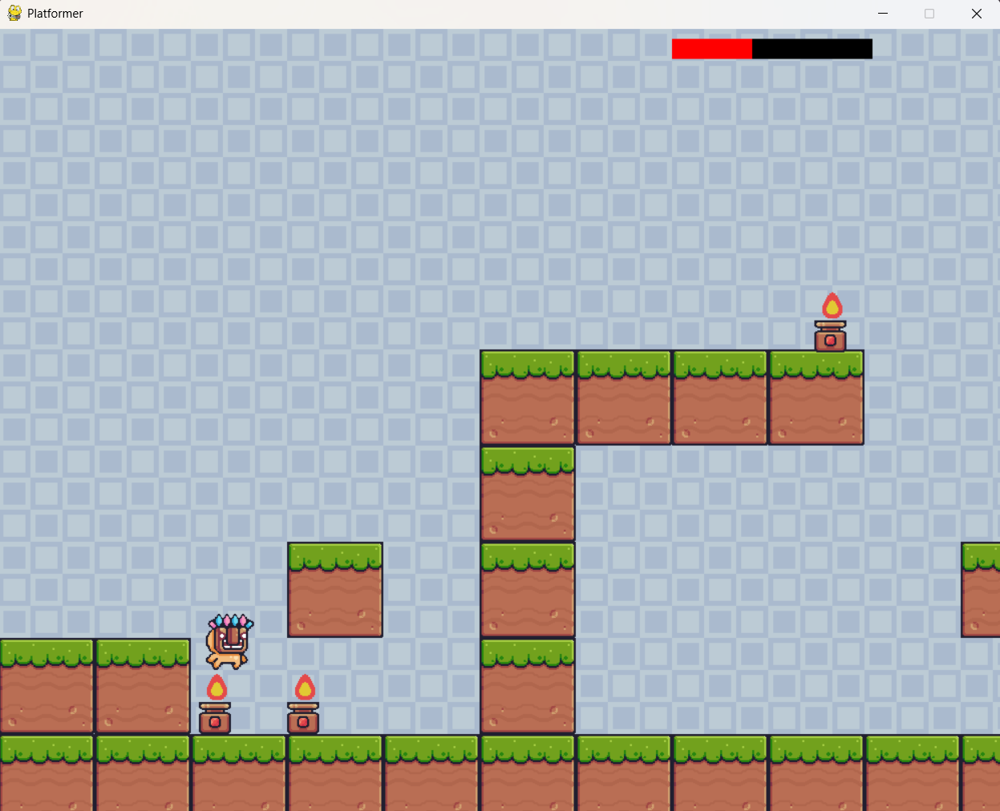
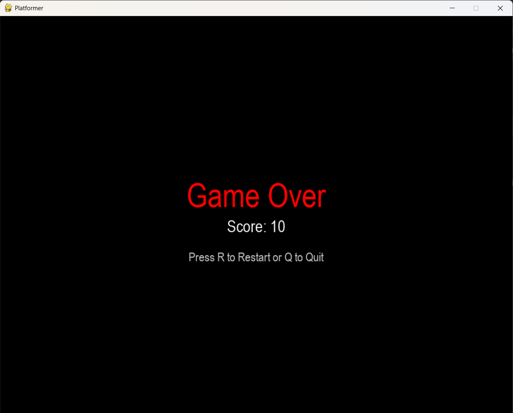
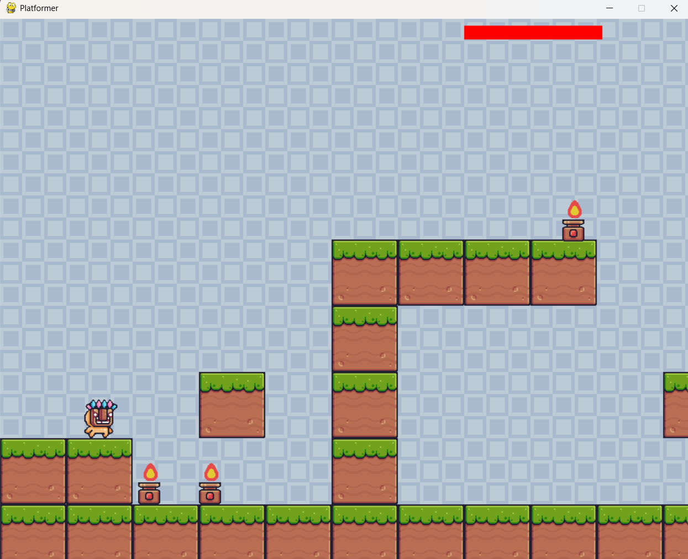

# 🕹️ Pygame Platformer Game

A 2D side-scrolling platformer built with **Python** and **Pygame**.

---

## 🚀 Features

- 🎮 Smooth player movement (left, right, jump, double jump)
- 🔥 Animated fire hazard
- 🧱 Platforms and terrain with collision detection
- 🌌 Scrolling background
- 🧠 Mask-based pixel-perfect collision
- 🧼 Clean object-oriented structure

---

## 📁 Project Structure

```
project/
├── assets/
│   ├── Background/
│   └── ...
├── docs/
│   └── img/       # Game screenshots
├── main.py        # Main game logic
└── README.md
```

---

## 🛠️ Requirements

- Python 3.7+
- Pygame

Install dependencies with:

```bash
pip install pygame
```

---

## ▶️ How to Run

```bash
python main.py
```

Make sure all required assets are located inside the `assets/` directory.

---

## 🎮 Controls

| Key        | Action              |
|------------|---------------------|
| `← / →`    | Move left/right     |
| `Space`    | Jump (double jump)  |
| `ESC` / ❌ | Quit the game       |

---

## 🧠 Code Overview

- `Player`: Manages player movement, jumping, and animation.
- `Object`: Base class for game objects.
- `Block`, `Fire`: Subclasses for terrain and hazards.
- `get_background()`, `draw()`: Handle rendering and tiling.
- `handle_move()`: Handles keyboard input and movement.
- `collide()`, `handle_vertical_collision()`: Handle collisions.

---

## 📸 Screenshots

### Gameplay





### Game over



---

## ✅ TODO

- [ ] Add enemy objects
- [ ] Create collectible items (coins, gems)
- [ ] Add audio (background music & effects)
- [ ] Create multiple levels with a level loader

---

## 👨‍💻 Author

**Tharindu Lakshitha**

Feel free to fork and improve the project or open issues with suggestions!

---

## 📄 License

This project is open-source. Add a LICENSE file if needed.
